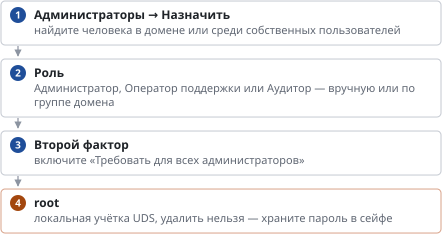
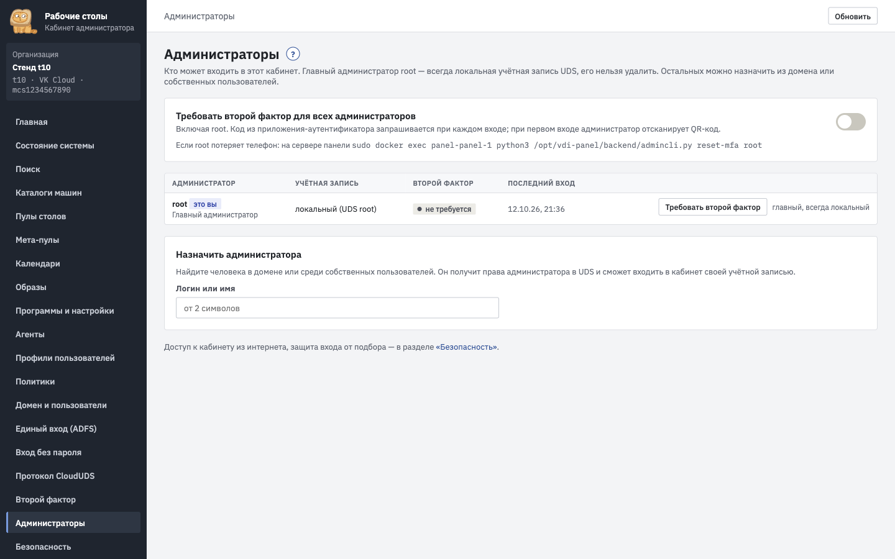

# Администраторы кабинета

*Руководство администратора → Безопасность*

> Как дать и забрать доступ администратору, что он получает, второй фактор, роли (Администратор, Оператор поддержки, Аудитор) и роли по группам домена, второй фактор, аудит и все уровни доступа к системе.



**Схема текстом:**

1.  **Администраторы → Назначить** — найдите человека в домене или среди собственных пользователей
2.  **Роль** — Администратор, Оператор поддержки или Аудитор — вручную или по группе домена
3.  **Второй фактор** — включите «Требовать для всех администраторов»
4.  **root** — локальная учётная запись UDS, удалить нельзя — храните пароль в сейфе (внимание)

## Кто такой администратор

- Администратор входит в кабинет (`/admin/`) своей учётной записью — доменной или собственной. В кабинет пускаются только учётные записи из списка «Администраторы», что бы ни было записано в UDS.
- Что ему можно, определяет **роль** (ниже). Права проверяет сервер кабинета на каждом запросе; кнопки, недоступные роли, кабинет просто не показывает. Действия выполняются от имени человека и пишутся в аудит вместе с ролью.
- **root** — главный администратор: всегда локальная учётная запись UDS с ролью «Администратор», его нельзя удалить или сделать доменным. Пароль выдаёт мастер установки на экране «Результат»; смените его после первого входа и храните в сейфе.

## Роли

| Роль | Может | Не может |
|----|----|----|
| **Администратор** | всё: пулы, образы, доступ, размещение, сертификаты, безопасность, резервные копии, хранилища секретов, администраторы; права администратора в UDS и штатная админка `/uds/adm/` | — |
| **Оператор поддержки** | поиск сотрудников и столов; выход из сеанса, перезагрузка, выключение, сброс и пересоздание стола; персональный доступ к пулам; сброс пароля собственных пользователей; решения по запросам сотрудников; восстановление профиля; журнал и аудит; просмотр пулов, домена, состояния системы | администраторы, сертификаты, «Безопасность», белые списки, резервные копии, «Размещение», образы и удаление пулов, интеграции, хранилища секретов; прав в UDS нет, штатная админка UDS закрыта |
| **Аудитор** | всё только на просмотр, включая журнал, аудит, администраторов и хранилища секретов (без значений секретов) | любые изменения; прав в UDS нет |

Оператор и аудитор не получают прав в UDS: кабинет выполняет их действия своей служебной учётной записью и пишет в журнал имя человека. Поэтому обойти роль запросами к REST UDS или через `/uds/adm/` нельзя — их собственный токен UDS кабинет не хранит. Полная таблица «право × роль» — **«Администраторы»** → «Что может каждая роль». Как устроена проверка и почему её нельзя обойти — [«Роли администраторов: как устроено и как защищено»](roles.md).

## Роли по группам домена

- «Администраторы» → «Роли по группам домена»: имя группы для каждой роли, например `VDI-Admins`, `VDI-Support`, `VDI-Audit`. Кабинет добавит группы в UDS — без этого UDS не пускает человека, которого нет ни в одной известной ему группе.
- Член группы получает роль при входе в кабинет, без ручного списка; в списке он отмечен «по группе …». Роль пересчитывается при каждом входе: вышел из группы — при следующем входе роли нет, права UDS снимаются; изменение роли — уведомление в канал «Безопасность».
- В нескольких группах — сильнейшая роль (Администратор, затем Оператор, затем Аудитор). Назначение вручную важнее группы: так задают исключения и роли собственным пользователям.
- Действующий сеанс кабинета живёт до 8 часов: выход из группы срабатывает со следующего входа. Срочно — «Убрать из списка»: сеансы завершатся сразу.

## Как дать доступ

1.  **«Администраторы»** → «Назначить вручную»: выберите роль, введите логин или имя (от 2 символов), выберите человека — из домена или из собственных пользователей. Домен должен быть подключён в «Домен и пользователи».
2.  Сообщите ему адрес кабинета: `https://<имя портала>/admin/`. Если кабинет закрыт из интернета или включён белый список адресов ([«Как ограничить доступ к кабинету и порталу»](access-limit.md)), он должен входить из разрешённой сети — изнутри или через VPN.
3.  Если второй фактор обязателен, при первом входе кабинет покажет QR-код — его сканируют приложением-аутентификатором (Google Authenticator, Яндекс Ключ и т. п.).
4.  Проверьте в списке: «Последний вход» заполнился.

## Как сменить роль

- В списке «Администраторы» выберите новую роль у человека и подтвердите. Его открытые сеансы кабинета завершаются; новая роль — со следующего входа. Права UDS выдаются (Администратор) или снимаются (остальные) сразу.
- Свою роль понизить нельзя — это делает другой администратор. Роль по группе домена меняется в домене, а не в кабинете. Роль root не меняется.
- Без входа в кабинет (последний администратор потерял доступ) — на узле кабинета от root: `sudo docker exec panel-panel-1 python3 /opt/vdi-panel/backend/admincli.py set-role <логин> admin`.

## Как забрать доступ

- «Администраторы» → «Снять права» у человека: он теряет доступ к кабинету и права администратора UDS, его открытые сеансы кабинета завершаются сразу на всех узлах; в канал «Безопасность» уходит уведомление.
- Уходит сотрудник — снимите права администратора, затем отключите его как сотрудника: [«Как отключить уволенного сотрудника»](offboard.md). Доменную учётную запись заблокируйте в AD.
- Если у человека был доступ к ВМ мастера или узлам по SSH, к консоли VK Cloud или к ключу восстановления — смените их (таблица ниже и [«Пароли и секреты»](secrets.md)).

## Второй фактор

- «Требовать второй фактор для всех администраторов» — включая root; код запрашивается при каждом входе. Можно требовать для ролей («Требовать для ролей») и для отдельных людей.

- Потерян телефон — другой администратор нажимает «Сбросить второй фактор»: при следующем входе будет новый QR-код.

- root потерял телефон и других администраторов нет — на узле кабинета (брокере) от root (там же `admincli.py list` — список администраторов):

  ``` bash
  sudo docker exec panel-panel-1 python3 /opt/vdi-panel/backend/admincli.py reset-mfa root
  ```

## Аудит

Входы в кабинет (в том числе неудачные) и все действия администраторов — **«Журнал»** → «Аудит», с именем и адресом. Уведомление «Вход администратора в кабинет» ([«Уведомления администраторам»](notify.md)) сообщает о каждом входе; аудит можно отправлять в SIEM.

## Все уровни доступа к системе

| Уровень | Кто получает | Что даёт | Как выдаётся и отзывается |
|----|----|----|----|
| Кабинет администратора | назначенные вручную и по группам домена, root | в пределах роли: Администратор — всё, Оператор поддержки — работа со столами и сотрудниками, Аудитор — просмотр | «Администраторы»: роль, «Снять права», группы ролей |
| Штатная админка UDS (`/uds/adm/`) | только роль «Администратор» | все объекты брокера напрямую | вместе с кабинетом; из интернета закрывается вместе с кабинетом («Безопасность») |
| Мастер установки | кто входит на ВМ мастера по SSH | установка, обновление и восстановление; SSH-ключ ко всем узлам и секреты установки | учётные записи и ключи SSH ВМ мастера; ссылка входа — `sudo cloududs-installer link`; между обновлениями ВМ можно выключить |
| Узлы по SSH | администраторы серверов (через бастион или ВМ мастера) | root на узлах: данные, секреты ролей | ключи SSH в консоли VK Cloud и на узлах; группы безопасности (порт 22) |
| Консоль VK Cloud | администраторы проекта, сервисные учётные записи | ВМ, диски, сети, плавающие IP, DNS проекта | роли VK Cloud в «Управлении доступами»; права сервисных учётных записей — [«Учётные записи и права»](accounts.md) |
| Ключ восстановления | хранитель ключа (сейф) | расшифровка резервных копий | выдаётся один раз при включении копий; смена — новый ключ в «Резервном копировании» |
| Хранилища секретов | учётные записи хранилищ (VK Cloud, Vault организации) | копия секретов установки: мастер-ключ, пароли баз, ключи UDS, SSH-ключ к узлам | политики самого хранилища; подключение — [«Хранилища секретов»](vault.md) |

[](img/ui-admins.png)

Администраторы кабинета

---
[Оглавление](README.md)
