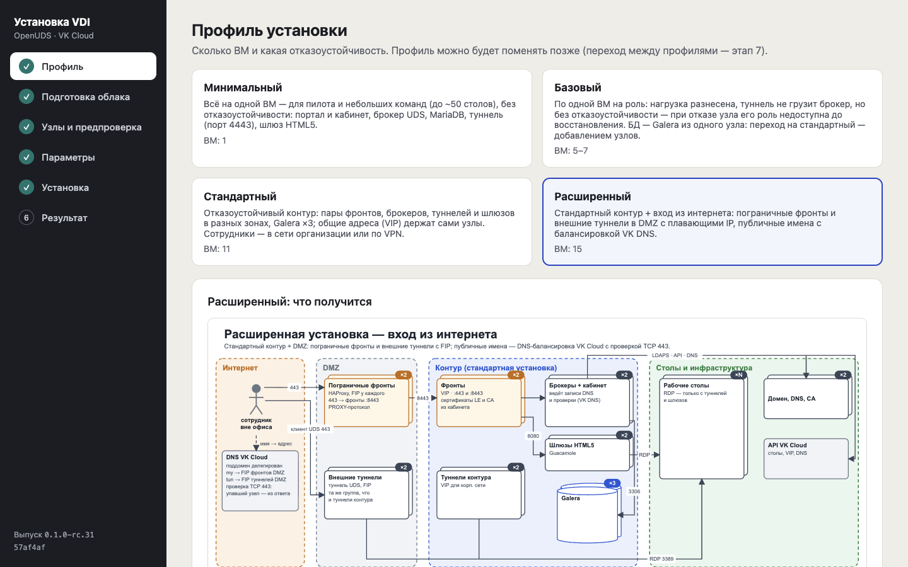
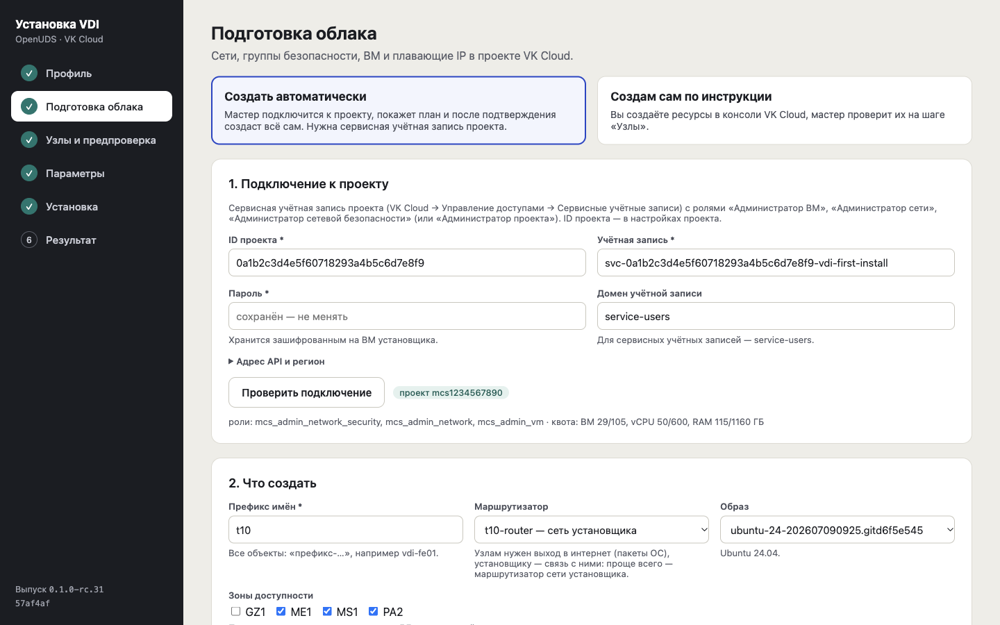
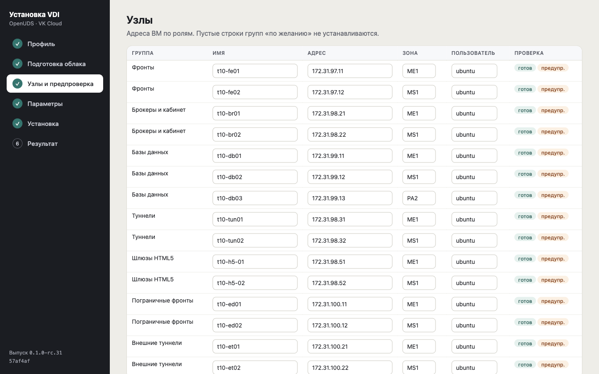
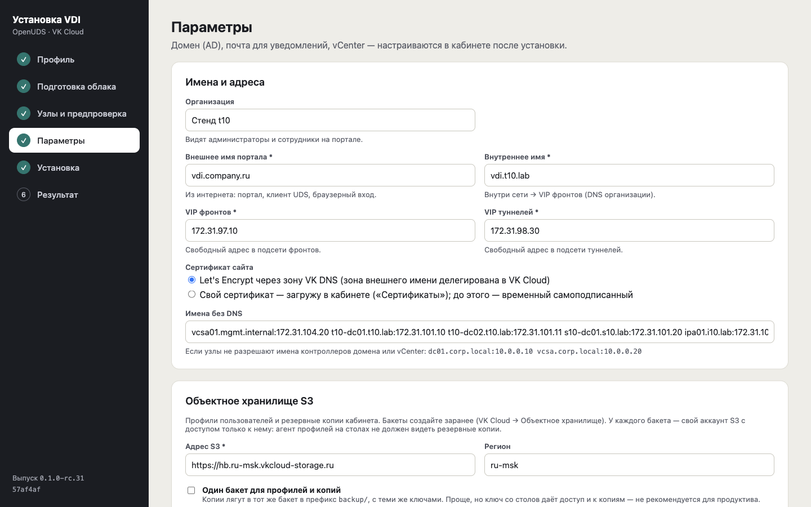
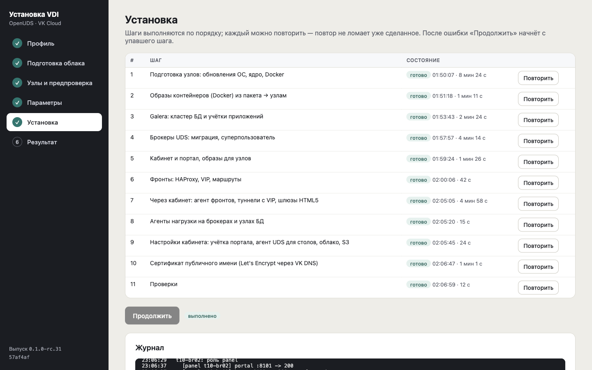
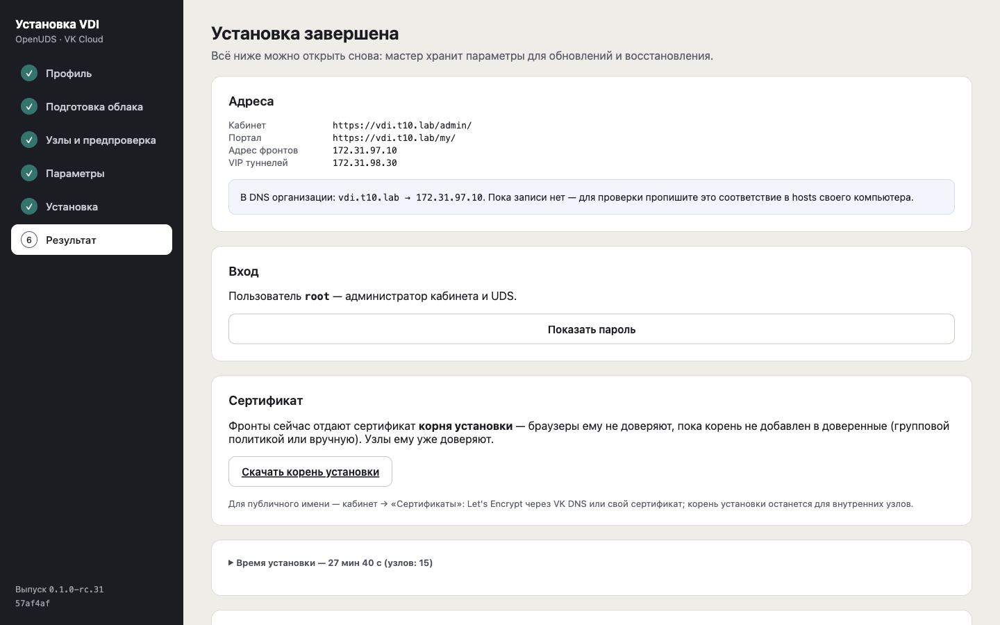

# Установка в VK Cloud: профили и порядок

*Начало работы · обновлено 17.10.2026*

> Пошагово от пустого проекта VK Cloud до первого стола: подготовка проекта, мастер установки, настройка в кабинете.

## Профили установки

Профиль установки — состав и размер серверной части CloudUDS в проекте VK Cloud: сколько ВМ, какие роли на них и есть ли отказоустойчивость. Не путать с профилями пользователей (папки сотрудников в S3).

| Профиль установки | Минимальный | Базовый | Стандартный | Расширенный |
|----|----|----|----|----|
| **Для чего** | пилот, небольшая команда (до ~50 столов) | рабочая установка без отказоустойчивости | рабочая установка в сети организации | стандартный + вход сотрудников из интернета |
| **Отказоустойчивость** | нет: одна ВМ | нет: по одной ВМ на роль | пары и Galera ×3 в разных зонах доступности | как у стандартного; внешний вход тоже парный |
| **ВМ в проекте** | 1: портал, кабинет, брокер, MariaDB, туннель, HTML5 | 5: фронт, брокер, БД, туннель, шлюз HTML5 (+2 в DMZ по желанию) | 11: фронты ×2 (VIP), брокеры ×2, Galera ×3, туннели ×2 (VIP), шлюзы HTML5 ×2 | 15: стандартный + пограничные фронты ×2 и внешние туннели ×2 в DMZ с плавающими IP |
| **Вход сотрудников** | из внутренней сети | из внутренней сети; из интернета — с узлами DMZ | внутреннее имя портала (vdi.компания.local) за VIP фронтов | внутреннее имя + публичное имя с DNS-балансировкой VK Cloud |
| **Установка мастером** | 14–19 мин | 22–25 мин | 32–45 мин | ~36 мин |
| **vCPU** | 8 | 14 (с DMZ — 18) | 30 | 38 |
| **RAM, ГБ** | 16 | 28 (с DMZ — 36) | 60 | 76 |
| **Диски SSD, ГБ** | 100 | 140 (с DMZ — 180) | 320 | 400 |
| **Плавающие IP** | 0 | 0 (с DMZ — 2) | 0 | 4 |

Ресурсы — только серверная часть, без ВМ мастера (2 vCPU, 4 ГБ RAM, 40 ГБ SSD) и без столов. Разбивка по ролям для расчёта стоимости — [«Что нужно до установки» → «Серверы и ресурсы по профилям установки»](prereq.md).

Время — от новой ВМ мастера до конца проверок, без заполнения экранов (ещё 10–20 минут в первый раз). Смену профиля установки мастер пока не делает: выбирайте профиль под целевую нагрузку. Схемы профилей установки — [«Схемы архитектуры»](topology.md), требования — [«Что нужно до установки»](prereq.md), какие отказы каждый профиль переживает сам и как восстанавливаться — [«Отказы и восстановление (DR)»](dr.md).

Столы во всех профилях создаются в проекте VK Cloud. Свой VMware vSphere заказчика (опция, например на VK Cloud Bare Metal as a Service) подключается после установки в «Размещении» — [пулы в VMware vSphere (опция)](vsphere.md).

## 1. Подготовка в VK Cloud и в организации

Всё, что мастер установки не может сделать сам. Сети, группы безопасности, ВМ и плавающие IP он создаёт в проекте сам.

**`1.` Проект VK Cloud**

Где: консоль VK Cloud

- проект в регионе Москва или Казахстан; квоты под профиль установки ([ресурсы по профилям](prereq.md)): ВМ, vCPU, ОЗУ, диски, плавающие IP (4 — для входа из интернета), группы безопасности, сети, плюс запас под рабочие столы
- сервисная учётная запись для мастера: «Управление доступами» → «Сервисные учётные записи», роли «Администратор ВМ», «Администратор сети» и «Администратор сетевой безопасности» либо «Администратор проекта»; ID проекта указан в настройках проекта
- учётная запись, под которой UDS создаёт рабочие столы: можно ту же; для эксплуатации рекомендуется отдельная с ролью «Младший администратор ВМ»
- по желанию — бакеты в «Объектном хранилище» для профилей сотрудников и резервных копий, у каждого свой аккаунт S3 с доступом только к нему; можно подключить и после установки
- по желанию — зона внешнего имени (например, поддомен my.компания.ru), делегированная в DNS VK Cloud: тогда мастер сам создаст DNS-записи входа из интернета и сможет выпустить сертификат Let's Encrypt; без зоны записи создаются вручную у своего DNS-провайдера. Распределение по узлам через DNS (GSLB) включает поддержка VK Cloud по запросу

**`2.` Связь с организацией**

Где: сеть организации, домен, DNS

- контроллеры домена доступны из проекта (VPN или прямое подключение к сети организации): LDAPS 636, Kerberos 88, DNS 53, SMB 445
- из сетей пользователей (офис, VPN) есть маршрут в проект: по нему сотрудники подключаются к фронтам и туннелям (порт 443)
- учётные записи домена для чтения каталога и ввода рабочих столов в домен (права — [«Учётные записи и права»](accounts.md))
- решение по сертификату внутреннего имени: сертификат CA организации (AD CS) или корень установки, который мастер выпустит сам

**`3.` ВМ мастера**

Где: консоль VK Cloud, затем SSH на ВМ

Заранее: доступ ВМ к GitHub или к VK Cloud S3 либо заранее скачанный пакет выпуска

- ВМ Ubuntu 24.04, 2 vCPU / 4 ГБ / 40 ГБ в проекте; проще всего — в сети с маршрутизатором, который мастер возьмёт и для узлов. В группе безопасности ВМ разрешите SSH (порт 22) со своего адреса
- подключение по SSH закрытым ключом ключевой пары ВМ (файл `.pem` из VK Cloud или свой закрытый ключ): `ssh -i <ключ> ubuntu@<адрес ВМ>`. Указывайте закрытый ключ, а не файл `*.pub`: с открытым ключом SSH пишет `Load key ... invalid format` и `Permission denied (publickey)`. Ошибка `UNPROTECTED PRIVATE KEY FILE` — `chmod 600 <ключ>` (в Windows оставьте права на файл только себе). ВМ без плавающего IP — через бастион: `ssh -J <пользователь>@<бастион> -i <ключ> ubuntu@<адрес ВМ>`
- на ВМ: `curl -fsSLO https://raw.githubusercontent.com/jaland-hara/CloudUDS-release/main/install.sh` (или из VK Cloud S3: `https://hb.ru-msk.vkcloud-storage.ru/sources/cloududs/install.sh`), затем `sudo bash install.sh`. Скрипт спросит, откуда скачать выпуск — GitHub или VK Cloud S3 (`--from github` / `--from s3`); пакет качается в 8 потоков, при недоступности источника — из другого. Без интернета: `sudo bash install.sh /путь/cloududs-X.Y.Z.tar`. Подпись пакета проверяется до распаковки
- мастер доступен только на самой ВМ (127.0.0.1:8200). Откройте его со своего компьютера через SSH-туннель: `ssh -i <ключ> -N -L 8200:127.0.0.1:8200 ubuntu@<адрес ВМ>` — окно с командой держите открытым, затем откройте ссылку входа, которую напечатал скрипт. Порт 8200 на компьютере занят — `-L 18200:127.0.0.1:8200` и порт 18200 в ссылке. Новая ссылка — `sudo cloududs-installer link`. Открывать порт 8200 в группе безопасности не нужно

Проверка: мастер открывается в браузере по ссылке через туннель; при обрыве туннеля страница перестаёт отвечать — запустите туннель снова

## 2. Мастер установки

Шесть экранов по порядку. Мастер хранит введённое: его можно закрыть и продолжить, любой шаг — повторить. После перезагрузки страницы мастер открывает тот же экран.

**`4.` Профиль установки**

Где: мастер → «Профиль установки»

- минимальный, базовый, стандартный или расширенный; мастер показывает схему, состав и размеры узлов. Сменить профиль после установки пока нельзя

**`5.` Подготовка облака**

Где: мастер → «Подготовка облака» → «Мастер создаст сам»

Заранее: сервисная учётная запись проекта (шаг 1)

- подключение к проекту: регион (Россия или Казахстан — от него зависят адрес API и S3), ID проекта, учётная запись, пароль, домен `service-users` → «Проверить подключение»
- что создать: префикс имён (начало имени всех объектов, например vdi → vdi-fe01), маршрутизатор (сети ВМ мастера или новый с выходом в интернет), образ Ubuntu 24.04, зоны доступности, подсети, тип дисков, семейство типов ВМ (список берётся из проекта; для каждой роли мастер выбирает наименьший подходящий тип)
- DNS узлов и DNS сети рабочих столов — контроллеры домена: столы входят в домен и находят портал по внутреннему имени
- сети пользователей — из них разрешены подключения к порталу и туннелям; «Вход из интернета» — узлы DMZ и свободные плавающие IP проекта
- «Рассчитать план» → «Создать ресурсы»: сети, группы безопасности с правилами (включая RDP и агент UDS к сети столов), порты VIP, диски, ВМ, плавающие IP. До нажатия «Создать ресурсы» в проекте ничего не создаётся; мастер ждёт, пока ВМ ответят по SSH

Проверка: ресурсы созданы, все ВМ на связи

**`6.` Узлы и предпроверка**

Где: мастер → «Узлы и предпроверка»

- список узлов заполнен по созданным ВМ — «Сохранить и запустить предпроверку»
- на каждом узле: SSH и `sudo`, Ubuntu 24.04, ресурсы против профиля, время, DNS, зеркало пакетов, свободные порты; затем порты между узлами
- если зеркала Ubuntu недоступны с узлов или выход в интернет только через прокси организации — «Прокси для пакетов ОС»

Проверка: «предпроверка пройдена»; закрытый порт — правило группы безопасности (облако применяет правила с задержкой до минуты)

**`7.` Параметры**

Где: мастер → «Параметры»

Заранее: по желанию: имена портала, бакеты S3 и их ключи

- название организации
- вход из сети организации: внутреннее имя (запись в DNS организации → внутренний адрес фронтов) и внутренние адреса (VIP) фронтов и туннелей — свободные адреса их подсетей; в профилях с одним фронтом VIP не нужен
- вход из интернета: внешнее имя (записи в публичном DNS → плавающие IP пограничных фронтов и внешних туннелей). Имена необязательны: одно имя может служить обоим путям; без имён портал открывается по IP фронтов
- сертификат портала: по умолчанию свой (загружается в кабинете, до этого работает сертификат корня установки); Let's Encrypt — при внешнем имени в зоне VK Cloud DNS
- имена, которые узлы должны знать без DNS (контроллеры домена, vCenter): `dc01.corp.local:10.0.0.10`
- S3: «Настроить сейчас» — бакет профилей и бакет резервных копий с ключами (общий бакет — только для тестов) или «Пропустить» — подключить позже в кабинете
- учётная запись для рабочих столов: та же, что у мастера, или отдельная

**`8.` Установка**

Где: мастер → «Установка» → «Начать установку»

- 12 шагов: подготовка узлов (обновление ОС, Docker) → загрузка образов контейнеров → база данных (Galera) → брокеры UDS → кабинет и портал → фронты → подключение туннелей, шлюзов HTML5 и узлов DMZ к кабинету → агенты мониторинга → настройки кабинета (облако для столов, S3, транспорты, вход из интернета) → сертификат Let's Encrypt (если выбран) → запись секретов во внешние хранилища (если подключены) → итоговые проверки
- над журналом — номер шага, процент, время шага и последняя строка журнала; предупреждения выделены цветом
- после ошибки журнал называет причину; устраните её и нажмите «Продолжить» — мастер продолжит с шага, на котором произошла ошибка

Проверка: шаг «Итоговые проверки» — все пункты «ok»

**`9.` Результат**

Где: мастер → «Результат»

- «Дальше — кабинет администратора»: ссылка на кабинет по имени и по IP фронтов, пользователь, адрес портала; пароль администратора кабинета и UDS — смените после первого входа
- если VK Cloud DNS не подключён — список DNS-записей входа из интернета, которые нужно создать у своего DNS-провайдера
- корень сертификатов установки — скачайте, если на внутреннем имени нет сертификата CA организации
- ВМ мастера сохраните: через неё выполняются обновления; между обновлениями её можно выключить — оплачивается только диск

## 3. Настройка в кабинете

Главная страница кабинета показывает эти шаги и что из них уже сделано. Туннели, шлюзы HTML5, внешний вход и подключение облака мастер уже настроил — в «Размещении» их нужно только проверить.

**`10.` DNS и сертификат внутреннего имени**

Где: DNS организации, **«Сертификаты»**

- записи в DNS организации: внутреннее имя портала → VIP фронтов, имя туннелей → VIP туннелей (адреса — на экране «Результат»)
- сертификат на внутреннее имя от CA организации — загрузить в «Сертификаты»; или раздать корень установки компьютерам сотрудников групповой политикой

Проверка: портал по внутреннему имени открывается без предупреждения браузера

**`11.` Организация**

Где: «Организация» (кнопка с названием вверху меню)

- код (входит в имена столов), часовой пояс, адрес портала для сотрудников
- запросы сотрудников — включить или выключить

**`12.` Облако для столов**

Где: **«Размещение»** → VK Cloud

- подключение, созданное мастером: проект, зона, сеть и группа безопасности столов по умолчанию
- ещё проекты VK Cloud — «Подключить»; свой vSphere заказчика (опция) — здесь же

Проверка: зелёная проверка у подключения

**`13.` Домен и пользователи**

Где: **«Домен и пользователи»**

Заранее: учётные записи чтения каталога и ввода в домен, корень CA контроллеров

- каталог сразу по LDAPS с корнем CA (без TLS сотрудники не смогут сменить пароль)
- «Проверить» у ввода в домен: кабинет создаёт и удаляет пробный компьютер в OU столов
- группы доступа (например, VDI-Users-…) и размещение столов по группам; без домена — собственные пользователи

Проверка: вход тестового сотрудника на портал

**`14.` Образ**

Где: **«Образы»**

Заранее: ВМ в сети столов проекта (подсеть «префикс-vdi») с доступом к порталу

- ВМ из образа VK Cloud (Windows — из ISO и по лицензии организации), нужные программы
- команда подготовки на ВМ: агент UDS, агент «Программы и настройки», часовой пояс; вариант «по имени» — с корнем CA, «по IP» — без проверки сертификата
- выключить ВМ и «Добавить образ» по ID ВМ — кабинет снимет тома-шаблоны

Проверка: образ «доступен»

**`15.` Каталог и пул**

Где: **«Каталоги машин»** → мастер пула

- образ, размер, тип диска, сеть, вход (домен / без домена), группы доступа, транспорты, питание
- публикация версии, первые столы — через 3–10 минут

Проверка: стол «готов», компьютер стола появился в OU домена

**`16.` Проверка сотрудником**

Где: портал (адрес из «Организации»)

Заранее: клиент CloudUDS на компьютере сотрудника (скачивается с портала)

- изнутри сети: вход доменной учётной записью, «Подключиться» (приложение) и «В браузере»
- с входом из интернета — то же с телефона или ноутбука без VPN по публичному имени

**`17.` Резервные копии**

Где: **«Резервное копирование»**

- включить ежедневную копию в бакет S3
- **ключ восстановления** показывается один раз — сохраните его вне кабинета

Проверка: «Сделать копию сейчас» — копия появилась

**`18.` Безопасность и эксплуатация**

Где: **«Безопасность»**, **«Уведомления»**, **«Второй фактор»**

- «Сертификаты узлов»: включить mTLS, проверить сеансы, затем «Требовать»
- защита входа, второй фактор для сотрудников и администраторов, доверенные сети; с входом из интернета — закрыть кабинет для интернета (бастион или VPN)
- уведомления администраторам (почта, Telegram), SIEM, профили сотрудников в S3, администраторы кабинета
- «Календари»: рабочие часы и праздники; в пуле — доступ по расписанию, прогрев столов к началу дня, публикация ночью

Обновление работающей установки — тем же мастером на ВМ мастера: [«Обновления»](updates.md) и UPGRADE.md в репозитории выпусков.

Мастер установки: профиль установки

Мастер установки: подготовка облака — подключение к проекту и что создать

Мастер установки: узлы по ролям и предпроверка

Мастер установки: имена, адреса, сертификат, S3

Мастер установки: шаги установки и журнал

Мастер установки: результат

---
[Оглавление](README.md)
