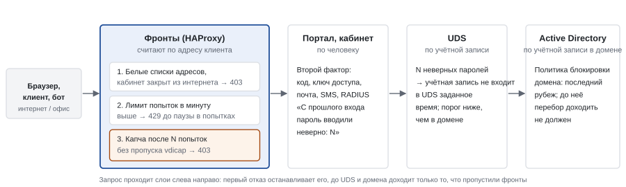
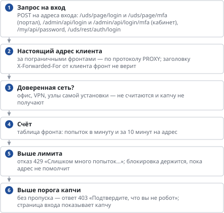
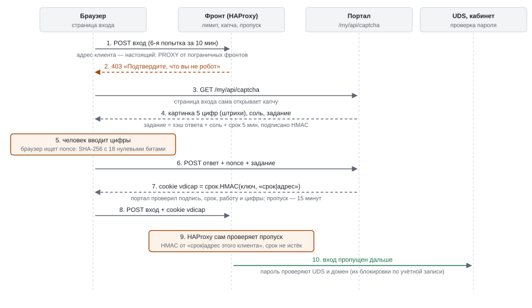
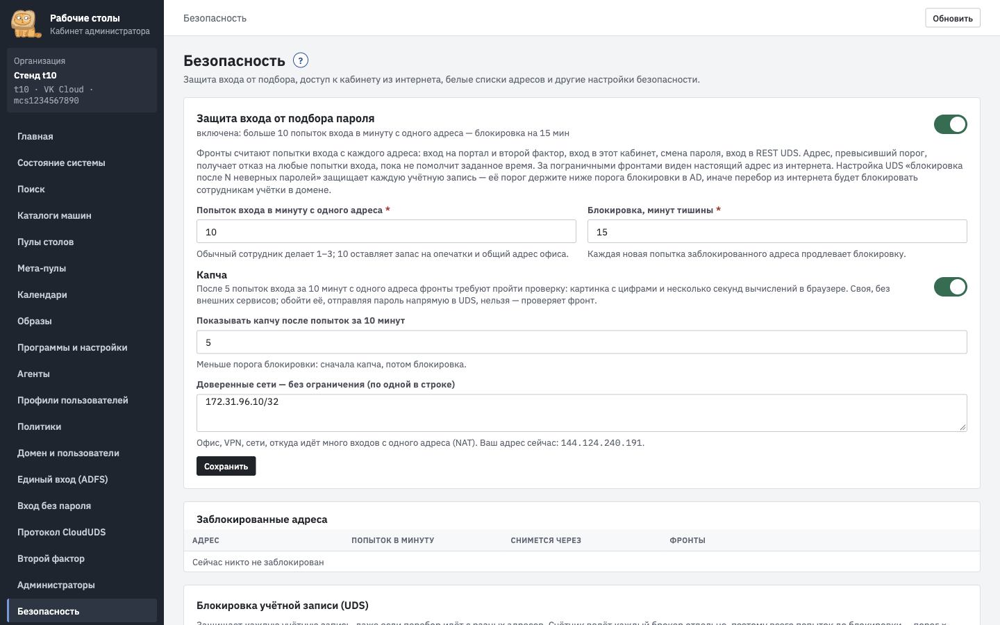
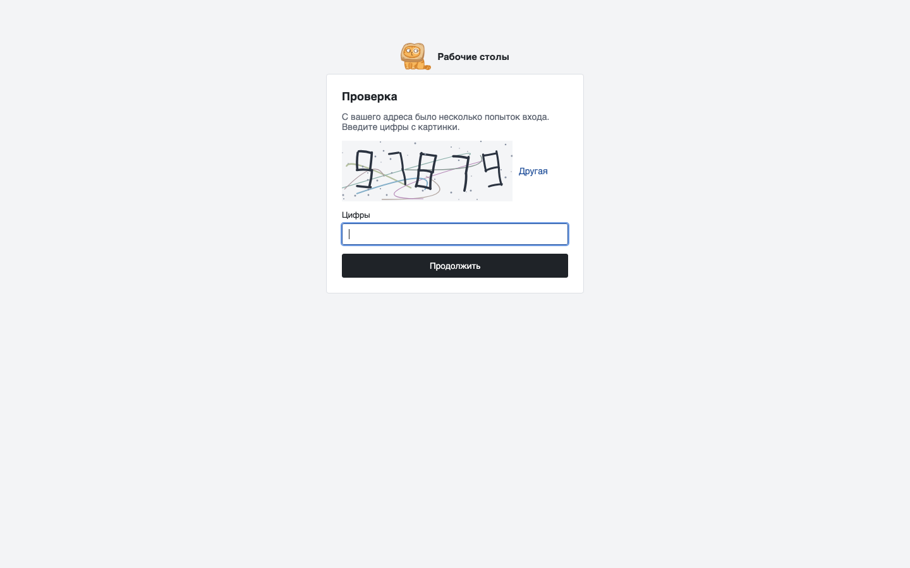

# Защита входа и капча: как устроено и как защищено

*Как устроено*

> Слои защиты от подбора пароля: лимит и капча на фронтах, блокировка учётных записей в UDS и AD, второй фактор; как фронт видит настоящий адрес и почему капчу нельзя обойти.

## Что защищаем

- Подбор пароля и перебор учётных записей через вход на портал, второй фактор, вход в кабинет, смену пароля сотрудником и вход в REST UDS. Именно эти адреса доступны из интернета без входа.
- Защита — в несколько слоёв: одного недостаточно. Фронты ограничивают **адрес** клиента, UDS и AD — **учётную запись**, второй фактор не даёт войти с подобранным паролем, белые списки и закрытие кабинета убирают поверхность атаки целиком.
- Настройки — **«Безопасность»**.

## Слои

**Схема текстом:**

- **Фронты (HAProxy)** считают по адресу клиента: белые списки и закрытый из интернета кабинет (403), лимит попыток в минуту (429 до паузы), капча после N попыток за 10 минут (без пропуска — 403).
- **Портал и кабинет** — по человеку: второй фактор; уведомление о неверных паролях с прошлого входа.
- **UDS** — по учётной записи: после N неверных паролей учётная запись временно не входит; порог ниже, чем в домене.
- **Active Directory** — политика блокировки домена, последний рубеж.

| Слой | Что считает | Что делает | Где настраивается |
|----|----|----|----|
| Фронты: лимит | попытки входа с одного адреса за минуту | выше порога — адрес получает отказ (429) на любые попытки входа, пока не помолчит заданное время; каждая новая попытка продлевает блокировку | «Безопасность» → «Защита входа»: попыток в минуту (10), минут тишины (15) |
| Фронты: капча | попытки входа с одного адреса за 10 минут | после порога вход принимается только с пропуском за решённую капчу | «Капча»: после скольких попыток (5) |
| UDS | неверные пароли одной учётной записи | учётная запись временно не входит в UDS | «Безопасность» → блокировка в UDS |
| Active Directory | неверные пароли учётной записи во всём домене | учётная запись блокируется в домене (и для почты, и для остального) | политика домена; кабинет показывает её значения |
| Второй фактор | — | подобранного пароля мало: нужен код, ключ доступа или подтверждение | «Второй фактор»; для администраторов — «Администраторы» |
| Белые списки, кабинет из интернета | — | кабинет и портал недоступны с посторонних адресов вовсе | «Безопасность» → «Белые списки адресов», «Доступ к кабинету из интернета» |

## Как считает фронт

**Схема текстом:**

1.  **Запрос на вход** — POST на адреса входа: /uds/page/login и /uds/page/mfa (портал), /admin/api/login и /admin/api/login/mfa (кабинет), /my/api/password, /uds/rest/auth/login
2.  **Настоящий адрес клиента** — за пограничными фронтами — по протоколу PROXY; заголовку X-Forwarded-For от клиента фронт не верит
3.  **Доверенная сеть?** — офис, VPN, узлы самой установки — не считаются и капчу не получают
4.  **Счёт** — таблица фронта: попыток в минуту и за 10 минут на адрес
5.  **Выше лимита** — отказ 429 «Слишком много попыток…»; блокировка держится, пока адрес не помолчит
6.  **Выше порога капчи** — без пропуска — ответ 403 «Подтвердите, что вы не робот»; страница входа показывает капчу

- Решение принимает сам фронт (HAProxy) до того, как запрос дойдёт до портала, кабинета или UDS. Поэтому обойти защиту, отправляя пароль прямо в `/uds/page/login` или REST UDS мимо нашей страницы, нельзя.
- Агент фронта раз в минуту берёт у кабинета настройки (лимиты, доверенные сети, ключ капчи, адреса для разблокировки) и отдаёт список заблокированных адресов. «Разблокировать» в кабинете снимает блокировку на всех фронтах в течение минуты.
- Новый заблокированный адрес — событие аудита `security.bruteforce` и уведомление в канал «Безопасность».

## Капча

**Схема текстом:**

1.  Браузер отправляет вход; на шестой попытке за 10 минут фронт отвечает 403 «Подтвердите, что вы не робот».
2.  Страница входа берёт у портала задание: картинку из 5 цифр, соль и подписанный ключом капчи хэш ответа со сроком 5 минут.
3.  Пока человек вводит цифры, браузер ищет число, при котором SHA-256 начинается с 18 нулевых бит.
4.  Портал проверяет подпись, срок, работу и цифры и ставит cookie vdicap = срок.HMAC(ключ, «срок\|адрес клиента») на 15 минут.
5.  Повторный вход идёт с cookie; HAProxy сам проверяет подпись от адреса этого клиента и срок, и только тогда пропускает запрос к UDS и кабинету.

- **Своя, без внешних сервисов:** ничего не уходит в Google или Яндекс, работает в закрытом контуре.
- **Картинка из пяти цифр** нарисована искажёнными штрихами (контуры, а не текст — из страницы её не прочитать), с шумовыми линиями и точками; у каждой цифры свой наклон и размер.
- **Проверка браузера:** пока человек читает цифры, браузер подбирает число, при котором SHA-256 начинается с 18 нулевых бит (около секунды-двух). Человеку незаметно, а массовое решение стоит процессорного времени.
- **Без состояния на сервере:** правильный ответ (его хэш с ключом), соль и срок (5 минут) приходят в браузер подписанными ключом капчи. Подменить ответ или продлить срок нельзя, а фронтам и порталу не нужно хранить выданные задания.
- **Пропуск** — cookie `vdicap`: срок (15 минут) и подпись HMAC-SHA256 ключом капчи от «срок \| адрес клиента». Подпись и срок проверяет сам фронт. Пропуск, унесённый на другой адрес, не действует; после срока нужна новая капча.
- **Ключ капчи** — общий для фронтов и портала, создаётся при первом использовании, на фронте лежит в файле только для root. Мастер-ключом кабинета он не зашифрован: пропуск подписывает портал, у которого мастер-ключа нет; ключ защищает только капчу.

## Почему фронт видит настоящий адрес

- Заголовок `X-Forwarded-For` от клиента фронт удаляет; оставляет его только от узлов кабинета (портал входит в UDS от имени сотрудника и передаёт его адрес).
- Пограничные фронты (DMZ) передают соединение по протоколу PROXY на отдельный порт внутренних фронтов, и этот порт принимает подключения только от зарегистрированных пограничных фронтов.
- Брокер и кабинет доверяют адресу только от своих фронтов. Тот же адрес видят журнал входов, аудит и привязка токенов туннелей.

## Свои узлы и доверенные сети

- Узлы кабинета не ограничиваются никогда: через фронты они передают в UDS входы сотрудников с портала. Капча для них закрыла бы вход всем.
- Доверенные сети (офис, VPN, NAT, откуда много сотрудников выходят с одного адреса) — без лимита и без капчи. Не вносите туда интернет целиком: защита по адресу для них выключена.

## Как согласовать пороги

- Капча раньше блокировки: порог капчи (5 за 10 минут) ниже лимита (10 в минуту). Сначала человеку показывают проверку, потом адрес блокируют.
- Блокировка учётной записи в UDS — раньше, чем в AD. Иначе перебор паролей из интернета будет блокировать сотрудникам учётные записи в домене: почта и компьютеры перестанут пускать. Каждый брокер считает отдельно, поэтому действующий порог UDS — порог × число брокеров. Кабинет показывает его рядом с политикой домена.
- Обычный сотрудник делает 1–3 попытки; общий адрес офиса — в доверенные сети.

## Что видит сотрудник и администратор

- Сотрудник: после нескольких неудачных попыток — капча на странице входа; при переборе — «Слишком много попыток входа с вашего адреса», блокировка уйдёт сама после паузы.
- Администратор: «Безопасность» → заблокированные адреса и «Разблокировать»; аудит — неудачные входы с адресами; уведомление «Подбор пароля: заблокировано адресов N».
- При следующем удачном входе на портал или в кабинет человек видит: «С прошлого входа пароль к вашей учётной записи вводили неверно: N» — с временем и адресом последней попытки. Если это был не он — повод сменить пароль.

## Ограничения

- Счёт ведёт каждый фронт сам. В паре работает фронт с VIP; после переезда VIP счёт начинается заново.
- Распределённый перебор с тысяч адресов почти не упирается в лимит по адресу — его держат блокировка учётных записей в UDS и AD и второй фактор. Поэтому второй фактор для доступа из интернета обязателен.
- Капча — защита от автоматического перебора, не от человека, вводящего пароли руками.

Безопасность: защита входа, капча, доверенные сети, заблокированные адреса

Капча на странице входа: цифры штрихами, проверка браузера идёт незаметно

---
[Оглавление](README.md)
