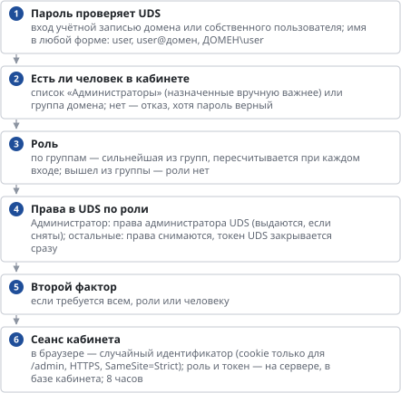

# Роли администраторов: как устроено и как защищено

*Как устроено*

> Три роли кабинета, проверка права на каждом запросе, почему оператор и аудитор не могут обойти роль через UDS и что видно в журнале.

## Что это

- В кабинет администратора входят люди с одной из трёх ролей: **Администратор** (всё), **Оператор поддержки** (помощь сотрудникам со столами, без инфраструктуры и секретов) и **Аудитор** (всё на просмотр).
- Роль назначают вручную в «Администраторах» или по группе домена — член группы получает роль при входе. Как назначать и снимать — [«Администраторы кабинета»](admins.md).
- Ниже — как кабинет проверяет роль и почему её нельзя обойти.

## Вход в кабинет

**Схема текстом:**

1.  **Пароль проверяет UDS** — вход учётной записью домена или собственного пользователя; имя в любой форме: user, user@домен, ДОМЕН\user
2.  **Есть ли человек в кабинете** — список «Администраторы» (назначенные вручную важнее) или группа домена; нет — отказ, хотя пароль верный
3.  **Роль** — по группам — сильнейшая из групп, пересчитывается при каждом входе; вышел из группы — роли нет
4.  **Права в UDS по роли** — Администратор: права администратора UDS (выдаются, если сняты); остальные: права снимаются, токен UDS закрывается сразу
5.  **Второй фактор** — если требуется всем, роли или человеку
6.  **Сеанс кабинета** — в браузере — случайный идентификатор (cookie только для /admin, HTTPS, SameSite=Strict); роль и токен — на сервере, в базе кабинета; 8 часов

## Каждый запрос

- Сервер кабинета находит сеанс по идентификатору из cookie: роль берётся оттуда, браузер её не передаёт и подменить не может.
- Изменяющий запрос (не GET) принимается только с заголовком `X-Requested-With: vdi-panel` — защита от подделки запроса с чужого сайта.
- По шаблону адреса запроса (например `POST /api/sessions/{pid}/{sid}/logoff`) сервер берёт **право** из таблицы прав (`panel/backend/roles.py`) и проверяет, есть ли оно у роли. Нет — ответ 403 «Недостаточно прав: роль …», до какой-либо работы.
- **Адрес, которого нет в таблице, доступен только Администратору.** Новая функция кабинета закрыта для оператора и аудитора, пока её не разрешили явно: забыть закрыть нельзя, можно только забыть открыть.
- Дальше запрос идёт в UDS: Администратор — со своим токеном UDS (UDS сам проверяет его права), оператор и аудитор — со служебной учётной записью кабинета. Действие пишется в журнал и аудит с именем человека.

## Почему роль нельзя обойти

| Попытка | Что мешает |
|----|----|
| Включить скрытую кнопку в браузере или отправить запрос вручную | кнопки скрывает только интерфейс; право проверяет сервер на каждом запросе по роли из сеанса |
| Пойти в UDS напрямую: REST или штатная админка `/uds/adm/` | у оператора и аудитора нет прав администратора в UDS (кабинет снимает их при назначении, смене роли и каждом входе), а их токен UDS закрывается сразу после проверки пароля |
| Воспользоваться служебной учётной записью кабинета | её пароль и токен живут только на сервере кабинета и в браузер не попадают; действовать ею кабинет может лишь в пределах проверенного права |
| Новая функция кабинета, которую забыли описать | по умолчанию только Администратор; автоматический тест сверяет таблицу прав с кодом: аудитору нельзя ничего изменяющего, оператору — ровно список поддержки |
| Повысить себе роль | менять роли может только Администратор; свою роль понизить нельзя (чтобы не остаться без администратора), root — всегда Администратор |
| Пользоваться старым сеансом после смены роли | смена роли и снятие прав завершают сеансы человека на всех узлах кабинета сразу |
| Остаться в роли после ухода из группы домена | роль по группе пересчитывается при каждом входе; открытый сеанс доживает до 8 часов — срочно: «Убрать из списка» |
| Подобрать пароль | защита входа на фронтах (лимит, капча), блокировка в UDS и AD, второй фактор по ролям |

## Что видит оператор и аудитор

- Меню — только разделы роли. В разделах — только действия, которые роль может выполнить; остальные кнопки скрыты, а при попытке кабинет сразу отвечает, какой роли это не позволено.
- В шапке — плашка роли («Аудитор · только просмотр»). Ссылки на штатную админку UDS у них нет.
- Секретов не видит никто: пароли, ключи и токены кабинет в браузер не возвращает ни одной роли; аудитор видит в «Хранилищах секретов» только состояние.

## Права

Право — строка `<раздел>.<что>`: `pools.read` — смотреть пулы, `sessions.manage` — управлять сеансами, `desktops.recreate` — пересоздавать стол. Роль — набор прав. Таблица «право × роль» — **«Администраторы»** → «Что может каждая роль»; там же видно, сколько адресов кабинета даёт каждое право.

## Журнал и уведомления

- Вход в кабинет — в аудите с ролью. Назначение, смена роли, снятие прав, изменение групп ролей — в журнале и аудите, с уведомлением в канал «Безопасность».
- Роль по группе домена: первая выдача и изменение тоже уходят в «Безопасность».
- В журнале UDS действия оператора и аудитора записаны от служебной учётной записи кабинета; кто это был на самом деле — в аудите кабинета (время, имя, адрес).

## Ограничения

- Роли с областью действия (только пулы своего подразделения) — пока нет.
- Роли — для входа в кабинет паролем домена или собственного пользователя; вход в кабинет через ADFS не поддерживается.
- Восстановление доступа без кабинета — на узле кабинета: `admincli.py list`, `admincli.py set-role <логин> admin`.

---
[Оглавление](README.md)
