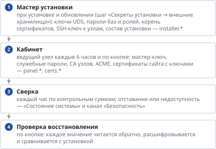
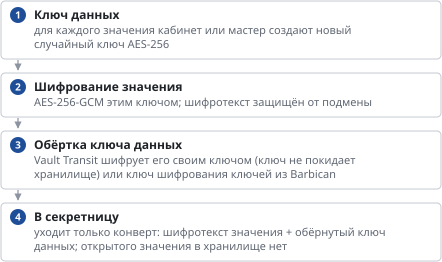

# Хранилища секретов и ключей: как устроено и как защищено

*Как устроено*

> Кто и что пишет во внешнее хранилище, шифрование конвертом, как защищены учётные данные хранилищ, угрозы и что им мешает.

## Что это

- Установка держит **копию** своих секретов во внешнем хранилище: в VK Cloud или в хранилище организации. Подключать и вести — [«Хранилища секретов и ключей»](vault.md).
- Хранилище секретов хранит значения, хранилище ключей — ключ, которым значения зашифрованы перед отправкой (шифрование конвертом, по желанию).
- Режим — «копия»: источник правды — сама установка. Узлы и кабинет при старте из хранилища ничего не читают, поэтому его недоступность не останавливает работу. Хранилище нужно для восстановления после аварии и для хранения ключей у организации.

## Кто что пишет

**Схема текстом:**

1.  **Мастер установки** — при установке и обновлении (шаг «Секреты установки → внешние хранилища»): ключи UDS, пароли баз и ролей, корень сертификатов, SSH-ключ к узлам, состав установки — installer.\*
2.  **Кабинет** — ведущий узел каждые 6 часов и по кнопке: мастер-ключ, служебные пароли, CA узлов, ACME, сертификаты сайта с ключами — panel.\*, certs.\*
3.  **Сверка** — каждый час по контрольным суммам; отставание или недоступность — «Состояние системы» и канал «Безопасность»
4.  **Проверка восстановления** — по кнопке: каждое значение читается обратно, расшифровывается и сравнивается с установкой

- Каждое значение — отдельная запись под каталогом установки (`cloududs/<код организации>/panel.master-key`). Рядом хранится SHA-256 исходного значения: сверка идёт по суммам, не читая и не расшифровывая значения.
- Пишется только изменившееся. В VK Cloud каждое изменение — новая версия секрета (прежние остаются в истории хранилища); в Vault — новая версия KV v2.

## Шифрование конвертом

**Схема текстом:**

1.  **Ключ данных** — для каждого значения кабинет или мастер создают новый случайный ключ AES-256
2.  **Шифрование значения** — AES-256-GCM этим ключом; шифротекст защищён от подмены
3.  **Обёртка ключа данных** — Vault Transit шифрует его своим ключом (ключ не покидает хранилище) или ключ шифрования ключей из Barbican
4.  **В хранилище секретов** — уходит только конверт: шифротекст значения + обёрнутый ключ данных; открытого значения в хранилище нет

- Прочитать значение можно только при доступе к обоим: к хранилищу секретов и к хранилищу ключей. Утечка одной из них секрет не раскрывает.
- В хранилище ключей передаётся только 32-байтовый ключ данных, не сами секреты.
- Без конверта значения защищает само хранилище: его шифрование хранения и политики доступа.

## Как защищены учётные данные хранилищ

- Пароль сервисной учётной записи, токен, `secret_id` AppRole хранятся в базе кабинета зашифрованными **мастер-ключом кабинета** (AES-256-GCM, отдельный контекст на каждое поле). Дамп базы без мастер-ключа их не раскрывает.
- В браузер они не возвращаются никогда: форма показывает «сохранён», пустое поле при сохранении значит «не менять».
- В мастере установки учётные данные лежат в зашифрованных секретах мастера (`secrets.enc`) и сами в хранилище не копируются.
- Мастер получает список хранилищ у кабинета (с учётными данными) только под администратором; выдача пишется в аудит с пометкой «предупреждение».
- Соединения — только HTTPS с проверкой сертификата (для внутреннего УЦ организации — его корень в настройках); системный прокси не используется, трафик секретов идёт напрямую.

## Угрозы и что им мешает

| Угроза | Что мешает |
|----|----|
| Утечка дампа базы кабинета | учётные данные хранилищ и все секреты в базе зашифрованы мастер-ключом, которого в базе нет |
| Доступ к хранилищу посторонним | политика хранилища только на каталог установки (AppRole/роль сервисной учётной записи); при шифровании конвертом — нужен ещё и доступ к хранилищу ключей |
| Подмена значения в хранилище | шифротекст AES-GCM не расшифруется после подмены; «Проверить восстановление» сравнивает каждое значение с установкой |
| Хранилище отстало или недоступно | сверка каждый час, строка в «Состоянии системы», уведомление «Безопасность»; работа установки не зависит от хранилища |
| Сотрудник поддержки смотрит секреты | раздел только у Администратора (менять) и Аудитора (смотреть состояние); значения не показываются ни одной роли |
| Потеря проекта или ВМ мастера | секреты мастера и кабинета есть в хранилище вне установки — восстановление на новой ВМ |
| Ключ восстановления резервных копий рядом с копиями | его закрытая половина в хранилище не записывается — копии и ключ к ним хранятся раздельно |

## Что важно знать

- VK Cloud «Менеджер ключей» пока не умеет шифровать через API и не привязывает ключ к секрету — поэтому хранилище ключей для VK Cloud — Barbican того же проекта (служба key-manager в каталоге проекта).
- Менеджер секретов VK Cloud работает асинхронно: кабинет ждёт завершения каждой записи. Значения больше 300 КБ туда не пишутся (сервис такие не завершает); секреты установки намного меньше.
- Поддерживаемые хранилища ключей на своей площадке: Vault/OpenBao/Stronghold Transit, OpenStack Barbican. KMIP и аппаратные модули (PKCS#11) — по запросу.
- Восстановление установки из хранилища кнопкой в мастере — в разработке; сейчас значения читаются средствами хранилища.

---
[Оглавление](README.md)
